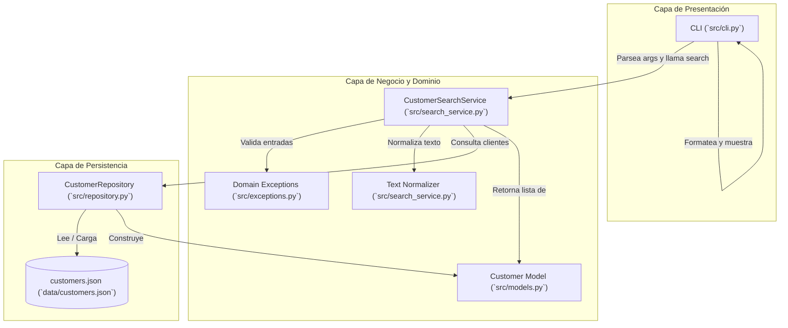

# Architecture — Customer Search

## Overview
La solución de Customer Search adopta una arquitectura desacoplada en tres capas (Layered Architecture): Presentación (CLI), Dominio/Servicio de Negocio (`CustomerSearchService`) y Acceso a Datos (`CustomerRepository`). El diseño prioriza la separación estricta de responsabilidades, la testabilidad sin dependencias externas y la portabilidad.



## Components

1. **`src/models.py` (Domain Model)**:
   - Define la entidad `Customer` como una estructura inmutable/dataclass con validación de tipos básicos.
   - Provee métodos auxiliares `from_dict()` y `to_dict()` para serialización.

2. **`src/exceptions.py` (Error Handling)**:
   - Define la jerarquía de excepciones del dominio: `CustomerSearchError`, `ValidationError`, `EmptyQueryError`, `QueryTooShortError`, `InvalidFieldError`, `InvalidStatusFilterError` y `CustomerRepositoryError`.

3. **`src/repository.py` (Data Access)**:
   - `CustomerRepository`: Maneja la lectura y persistencia de registros desde archivos JSON locales o listas en memoria.
   - Aisla a la lógica de negocio del formato y fuente de almacenamiento físico.

4. **`src/search_service.py` (Core Business Logic)**:
   - `CustomerSearchService`: Coordina la validación de parámetros de búsqueda (`query`, `field`, `status_filter`), normalización diacrítica de cadenas de texto y evaluación de coincidencias parciales (`substring match`).

5. **`src/cli.py` (Presentation / Entrypoint)**:
   - Construido con la librería estándar `argparse`.
   - Maneja argumentos de línea de comandos, invoca al servicio, captura excepciones para presentar mensajes descriptivos al usuario y genera una salida en formato de tabla ASCII limpia.

## Responsibilities

| Componente | Responsabilidad Principal | Lo que NO debe hacer |
| :--- | :--- | :--- |
| `Customer` (`models.py`) | Representar el estado e integridad de los datos de un cliente. | Filtrar o buscar otros clientes. |
| `CustomerRepository` (`repository.py`) | Cargar, deserializar y proveer la colección de clientes. | Ejecutar reglas de búsqueda o validación de CLI. |
| `CustomerSearchService` (`search_service.py`) | Validar criterios de búsqueda, normalizar cadenas y filtrar clientes coincidentes. | Imprimir en consola o leer directamente archivos JSON. |
| `CLI` (`cli.py`) | Parsear argumentos de terminal, capturar excepciones y renderizar resultados. | Contener lógica de filtrado o algoritmos de coincidencia. |

## Data Flow
1. El usuario invoca el comando CLI (e.g. `python -m src.cli --query "garcia" --status active`).
2. `src/cli.py` parsea los argumentos y llama a `CustomerSearchService.search(...)`.
3. `CustomerSearchService` invoca `validate_query(...)`: si la consulta es inválida (< 2 caracteres o vacía), lanza una excepción de validación que el CLI captura para imprimir en stderr.
4. `CustomerSearchService` solicita la lista de clientes al `CustomerRepository`.
5. Para cada cliente provisto por el repositorio:
   - Se evalúa el filtro de estado (`is_active`).
   - Se normalizan las cadenas con `unicodedata.normalize('NFKD', ...)` removiendo acentos y pasando a minúsculas.
   - Se verifica si `query_normalizado` es subcadena del campo indicado (`name`, `email` o ambos).
6. Los clientes coincidentes se ordenan alfabéticamente por nombre y se retornan a la CLI.
7. La CLI formatea la lista en una tabla visual con encabezados y contador total.

## Interfaces

### Repositorio
```python
class CustomerRepository:
    def __init__(self, data_source: Union[str, Path, List[Customer], None] = None):
        ...
    def get_all(self) -> List[Customer]:
        ...
```

### Servicio de Búsqueda
```python
class CustomerSearchService:
    def __init__(self, repository: CustomerRepository):
        ...
    def search(
        self,
        query: str,
        field: str = "all",
        status_filter: str = "all"
    ) -> List[Customer]:
        ...
```

### CLI
```bash
python -m src.cli --query <TEXT> [--field {all,name,email}] [--status {all,active,inactive}] [--json-path <PATH>]
```

## Error Handling
- Errores de validación (`ValidationError` y derivadas) son controlados y anticipados en la capa de servicio. La CLI los traduce en mensajes de error concisos para el usuario con código de salida `2`.
- Errores de acceso a datos (`CustomerRepositoryError`, archivo no encontrado o JSON malformado) terminan con código de salida `1` y mensaje en `stderr`.
- En caso de éxito, el código de salida es `0`.

## Testing Strategy
- **Pruebas Unitarias (`tests/test_domain.py`, `tests/test_search_service.py`, `tests/test_validation.py`)**:
  - Uso de repositorios en memoria para aislar la lógica de negocio sin I/O de disco.
  - Validación de acentos, mayúsculas, términos al inicio/medio/final, espacios redundantes.
  - Comprobación de que se lanzan las excepciones adecuadas.
  - Medición de rendimiento para 1,000 registros (< 50ms).
- **Pruebas de Integración (`tests/test_cli.py`)**:
  - Ejecución de la función `main` del CLI mediante simulación de argumentos (`sys.argv` o `capsys`) para verificar códigos de salida y salidas formateadas.

## Dependencies
- **Runtime**: Ninguna externa (Python 3.11+ con módulos nativos: `dataclasses`, `argparse`, `unicodedata`, `json`, `pathlib`, `typing`, `sys`, `time`).
- **Development / Testing**: `pytest` (>= 8.0.0).

## Design Decisions
1. **Normalización Diacrítica con Unicode NFKD**:
   - *Decisión*: Usar `unicodedata.normalize('NFKD', s)` y filtrar caracteres de la categoría `Mn` (Mark, Nonspacing).
   - *Razón*: Permite que búsquedas comunes en español como "jose", "perez", "angel" coincidan automáticamente con "José", "Pérez", "Ángel" sin necesidad de librerías externas como `unidecode`.
2. **Repositorio Desacoplado**:
   - *Decisión*: El servicio de búsqueda recibe una instancia de `CustomerRepository` vía inyección de dependencias en su constructor.
   - *Razón*: Facilita pruebas unitarias puras en memoria con `CustomerRepository(data_source=[...])` sin depender del sistema de archivos.
3. **Persistencia Basada en JSON**:
   - *Decisión*: Almacenar registros iniciales en `data/customers.json`.
   - *Razón*: Cumple con las restricciones de ADA-05 de mantener una solución liviana sin necesidad de configurar servicios de bases de datos.

## Trade-offs
- **Búsqueda secuencial $O(N)$ vs Índice invertido / Trie**:
  - Para catálogos pequeños a medianos (hasta 5,000 clientes), la búsqueda lineal en memoria tarda entre 1ms y 10ms, satisfaciendo ampliamente `NFR-01` (< 50ms) sin la sobrecarga ni complejidad de mantener un índice en memoria.
- **CLI nativo con `argparse` vs `click`/`typer`**:
  - Se prescinde de `click` o `typer` para mantener cero dependencias externas en tiempo de ejecución (`C-01`), aceptando una configuración ligeramente más verbosa en `argparse`.
